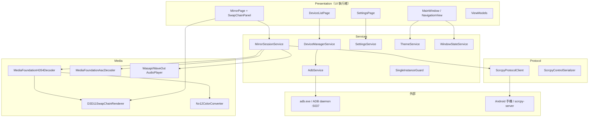
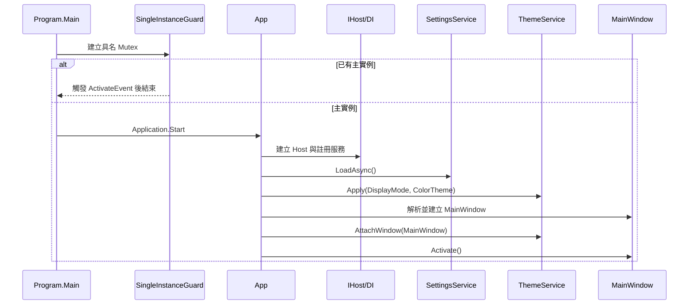
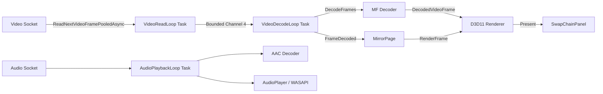
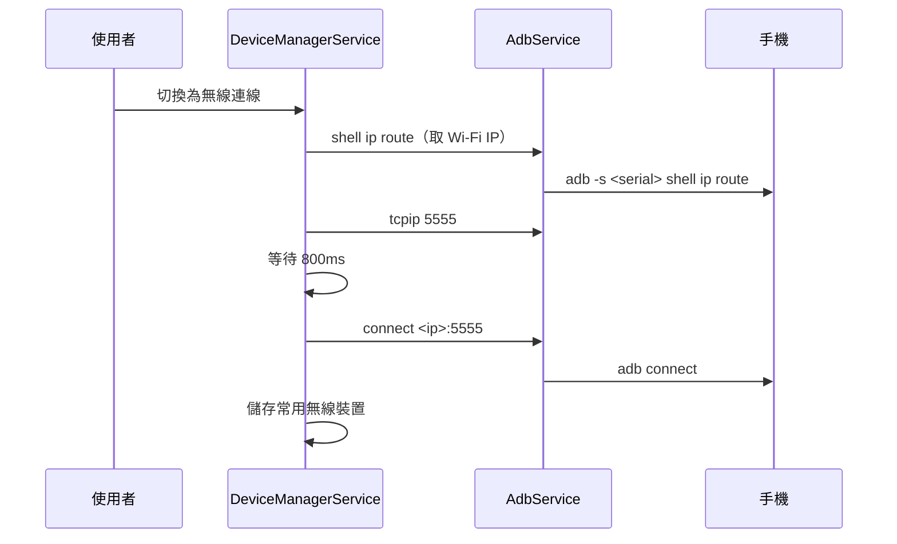
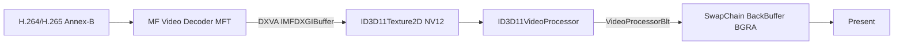
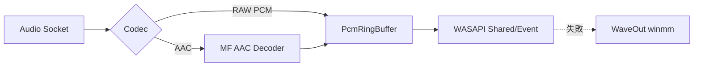

# 系統架構與技術文件

本文件說明「Android同步」的整體架構、執行緒模型、主要資料流與關鍵技術實作。系統設計取捨與需求請參閱 [DESIGN.md](DESIGN.md)。

---

## 1. 技術基線

| 項目 | 內容 |
| --- | --- |
| 語言 | C#（nullable、file-scoped namespace、unsafe 指標用於 COM／D3D11 互通） |
| 執行環境 | .NET 10（`net10.0-windows10.0.22000.0`） |
| UI | WinUI 3 / Windows App SDK 1.8、MVVM（CommunityToolkit.Mvvm） |
| 平台 | Windows 11 build 22000 以上，x64 與 ARM64 |
| 啟動 | `Microsoft.Extensions.Hosting` + 依賴注入 |
| 影音 | Media Foundation、Direct3D 11、WASAPI、winmm |
| 測試 | xUnit |
| 第三方 | `scrcpy-server`（Apache-2.0）、ADB（使用者自備） |

---

## 2. 高階架構



### 分層職責

| 層 | 職責 | 代表檔案 |
| --- | --- | --- |
| Presentation | 視窗、頁面、XAML 綁定、輸入事件、視覺狀態 | `Views/`、`ViewModels/` |
| Services | 業務流程、程序管理、連線、設定、主題、視窗狀態 | `Services/` |
| Protocol | scrcpy 握手、封包分幀、控制訊息序列化 | `Protocol/` |
| Rendering | 解碼、色彩轉換、D3D11 呈現、截圖 | `Rendering/` |
| Audio | PCM 緩衝、AAC 解碼、WASAPI／WaveOut 播放 | `Audio/` |
| Helpers | 座標與鍵盤映射、剪貼簿協調、手勢、截圖 | `Helpers/` |

---

## 3. 啟動與生命週期



- `Program.Main` 使用 `DISABLE_XAML_GENERATED_MAIN`，自行初始化 COM Wrappers 與 `DispatcherQueueSynchronizationContext`。
- 服務以 Singleton 註冊於 `App.xaml.cs`；View 透過 `App.GetService<T>()` 取得，避免直接 `new`。
- 關閉視窗時 `MainWindow.OnWindowClosing` 會先取消關閉、儲存視窗狀態、停止同步，再真正關閉。

---

## 4. 執行緒與資料流



| 執行緒／工作 | 說明 |
| --- | --- |
| UI 執行緒 | WinUI 視覺樹、頁面導覽、輸入事件、視窗操作。所有 UI 狀態更新經 `DispatcherQueue.TryEnqueue`。 |
| `VideoReadLoopAsync` | 從視訊 Socket 讀取封包，放入容量 4 的有界 `Channel`，形成背壓。 |
| `VideoDecodeLoopAsync` | 從 Channel 取封包餵入解碼器；有積壓時只更新 DPB、略過過時影格渲染，快速追幀。 |
| `AudioPlaybackLoopAsync` | 讀取音訊封包，RAW 直接寫入播放器；AAC 經 Media Foundation 解碼後寫入。 |
| `ControlWriteLoopAsync` | 將控制訊息合併寫入控制 Socket，降低小封包開銷。 |
| `ControlReadLoopAsync` | 解析裝置端剪貼簿、ACK 與 UHID 訊息。 |
| ADB Smart Socket | `host:track-devices-l` 持續接收裝置清單變化。 |
| 自動重連 | 獨立 Task，依 `1.5s / 3s / 5s` 退避重試。 |

### 併發保護
- `D3D11SwapChainRenderer` 以 `Lock` 保護裝置與交換鏈狀態；`DeviceLost` 事件從 `ThreadPool` 觸發，避免在鎖內同步回呼造成死鎖。
- `MirrorPage._rendererAttached` 為 `volatile`，確保 UI 與背景執行緒可見性。
- 控制訊息使用 `Channel<byte[]>` 無界佇列，單一讀取者、寫入者非同步。
- 剪貼簿序號以 `Interlocked.Increment` 產生，避免競爭。

---

## 5. ADB 與連線管理

### 5.1 工具解析順序

`AdbService` 依下列順序解析 `adb.exe` 與 `scrcpy-server`：

1. 設定頁指定路徑。
2. 程式目錄 `Tools\adb.exe`／`Tools\scrcpy-server`。
3. `ANDROID_HOME`／`ANDROID_SDK_ROOT` 下的 `platform-tools\adb.exe`。
4. `%LOCALAPPDATA%\Android\Sdk\platform-tools\adb.exe`。
5. 系統 `PATH`（僅 adb）。

解析結果會快取，設定變更時失效。

### 5.2 ADB Smart Socket

- 直連 `127.0.0.1:5037`，以 ADB 二進位協議通訊（4 位十六進位長度 + 指令）。
- `host:devices-l` 一次性查詢；`host:track-devices-l` 持續追蹤。
- `host-serial:<serial>:forward:tcp:<port>;localabstract:<name>` 直接建立轉發，失敗時退回 `adb forward` CLI；移除轉發使用 `host-serial:<serial>:killforward:tcp:<port>`。
- 減少啟動子行程的延遲，並即時反映 USB 插拔。

### 5.3 Wi-Fi 連線流程



Android 11+ 配對則使用 `adb pair <ip>:<port> <code>`，配對成功後再以 `adb connect <ip>:<connectPort>` 連線。

---

## 6. scrcpy 協議

### 6.1 連線順序

1. `adb push scrcpy-server /data/local/tmp/scrcpy-server.jar`
2. `adb forward tcp:<localPort> localabstract:scrcpy_<scid>`
3. 啟動 `app_process` 執行 `com.genymobile.scrcpy.Server`
4. 建立 Video → Audio（可選）→ Control 三條 TCP 連線
5. 讀取握手與裝置資訊

### 6.2 握手與版本相容

視訊串流初始格式：

| 版本 | 內容 |
| --- | --- |
| v2 / v3 | 12 bytes：`codecId(u32)`、`width(i32)`、`height(i32)` |
| v5.0+ | 4 bytes `codecId` + 12 bytes `writeSessionMeta`：`flags`、`width`、`height` |

程式以 `flags` 最高位（`0x80000000`）判斷 v5 格式。

視訊／音訊封包標頭為 12 bytes：`ptsAndFlags(u64)` + `payloadSize(i32)`。

| 旗標 | v2/v3 | v5.0+ |
| --- | --- | --- |
| Session meta | — | bit 63 |
| Config（SPS/PPS／AAC config） | bit 63 | bit 62 |
| Key frame | bit 62 | bit 61 |

串流中途的尺寸變更（旋轉）以 v5 session meta 封包傳送，程式會更新 `VideoWidth`／`VideoHeight` 並觸發畫面重配。

### 6.3 控制訊息

`ScrcpyControlSerializer` 產生 Android 端可解析的控制封包，包含：

- 觸控：`INJECT_TOUCH_EVENT`（Down / Move / Up，含多點 pointer id）
- 捲動：`INJECT_SCROLL_EVENT`
- 按鍵：`INJECT_KEYCODE`（含 `AndroidMetaState` 組合鍵）
- 文字：`INJECT_TEXT`（ASCII）
- 剪貼簿：`SET_CLIPBOARD`（可帶 `paste`）、`GET_CLIPBOARD`
- 顯示電源：`SET_DISPLAY_POWER`
- 旋轉：`ROTATE_DEVICE`

控制通道另提供讀取迴圈，接收 `TYPE_CLIPBOARD`、`TYPE_ACK_CLIPBOARD`、UHID 輸出等裝置訊息。

---

## 7. 視訊解碼與渲染

### 7.1 GPU 零拷貝路徑



- `MediaFoundationH264Decoder` 透過 `MFTEnumEx` 建立 H.264／HEVC 解碼器，設定 `MF_LOW_LATENCY`，並以 `MFT_MESSAGE_SET_D3D_MANAGER` 注入 `IMFDXGIDeviceManager`。
- 解碼輸出 `IMFDXGIBuffer` 取得 `ID3D11Texture2D` 與 subresource index。
- `D3D11SwapChainRenderer` 建立 `ID3D11VideoProcessorEnumerator`／`ID3D11VideoProcessor`，於 GPU 完成 NV12→BGRA、裁切與縮放。
- 快取 `ID3D11VideoProcessorInputView`（依 subresource index）與 `ID3D11VideoProcessorOutputView`，降低每幀 COM 配置。
- 啟用 `DXGI_SWAP_CHAIN_FLAG_FRAME_LATENCY_WAITABLE_OBJECT` 與 `SetMaximumFrameLatency(1)` 降低呈現延遲；失敗時退回一般交換鏈。
- 以 `IDXGISwapChain2::SetMatrixTransform` 將原始解析度畫面縮放至 `SwapChainPanel` 顯示區域，維持長寬比。
- 每幀渲染完成後立即釋放 DXVA surface，避免解碼器輸出表面池耗盡。

### 7.2 CPU 回退路徑

- 系統不支援 DXVA／HEVC 時，Media Foundation 輸出 NV12 系統記憶體。
- `Nv12ColorConverter` 支援可視區域裁切（`MF_MT_MINIMUM_DISPLAY_APERTURE`／`MF_MT_GEOMETRIC_APERTURE`），避免 16×16 巨集區塊補齊造成的綠色邊框。
- 使用 unsafe 指標、雙像素共用 UV 與大畫面 `Parallel.For` 轉換為 BGRA，再上傳至 GPU。

### 7.3 裝置遺失恢復

- 偵測 `DXGI_ERROR_DEVICE_REMOVED`／`DXGI_ERROR_DEVICE_RESET`。
- `RecoverDevice` 重建 D3D11 裝置、交換鏈與 Video Processor。
- `MirrorSessionService` 收到 `DeviceLost` 後觸發自動重連，重建解碼與串流工作階段。

### 7.4 截圖

- `TryCaptureCurrentFrameBgra` 從目前後備緩衝或最後影格取得 BGRA。
- `ScreenshotHelper` 以 PNG 編碼儲存至「圖片\AndroidSync」，並複製至剪貼簿（含 `Clipboard.Flush()`）。

---

## 8. 音訊管線



- Android 11+ 預設使用 AAC（`audio_codec=aac`），可切換 RAW（`raw`）。
- `MediaFoundationAacDecoder` 以 Media Foundation AAC MFT 解碼，重用 `IMFSample`／`IMFMediaBuffer`，以 `ReadOnlySpan<byte>` 零配置輸出 PCM。
- `PcmRingBuffer` 為固定容量環形緩衝，支援 frame alignment 與 80ms 延遲上限，避免延遲累積。
- `WasapiAudioPlayer` 使用共享模式、事件驅動，監聽預設音訊裝置變更並自動切換；初始化失敗時退回 `WaveOutAudioPlayer`（`winmm`）。
- 不支援音訊擷取的裝置會自動停用音訊，維持畫面同步。

---

## 9. 輸入與剪貼簿

### 9.1 座標映射

`CoordinateMapper` 將 `SwapChainPanel` 上的 DIP 座標，依實際顯示區域與手機解析度換算為裝置像素座標；`ViewportRect` 保存長寬比置中後的顯示矩形。

### 9.2 鍵盤映射

`KeyboardMapper` 將 Windows `VirtualKey` 映射為 Android `AndroidKeyCode`，並組合 `AndroidMetaState`（Shift／Ctrl／Alt／Meta／CapsLock）。非 ASCII 文字走 `SET_CLIPBOARD(paste: true)`。

### 9.3 剪貼簿協調

`ClipboardSyncCoordinator` 記錄最近一次同步內容與 IME 注入文字，避免：

- 電腦推送到手機後，手機回推造成迴圈。
- 中文 IME 暫時使用剪貼簿時，覆寫使用者原本的電腦剪貼簿。

### 9.4 手勢

`PinchGestureCalculator` 依 `Ctrl + 拖曳` 的起始與目前位置計算雙指中心、半徑與角度，轉為兩個 `INJECT_TOUCH_EVENT` 指標。

---

## 10. 設定、主題與視窗

### 10.1 設定儲存

- 位置：`%AppData%\AndroidSync\settings.json`
- 格式：JSON（camelCase、縮排）
- 寫入採暫存檔 + 原子搬移，降低損毀風險。
- 內容包含：工具路徑、鏡像選項、常用無線裝置、視窗狀態、顯示模式、主題。

### 10.2 主題

- `AppDisplayMode`：System／Light／Dark。
- `AppColorTheme`：ClassicBlue／EyeCareYellow／ForestGreen／TwilightPurple／NeutralGray。
- 每款主題為獨立 `ResourceDictionary`，同時定義淺色與深色 `ThemeResource`。
- `ThemeService` 替換資源字典後，短暫切換 `ElementTheme` 強制視覺樹重算，並同步標題列按鈕色彩與 `DWMWA_USE_IMMERSIVE_DARK_MODE`。
- 監聽 `UISettings.ColorValuesChanged`，跟隨系統模式時即時更新。

### 10.3 視窗狀態

- 關閉時儲存位置、大小與最大化狀態。
- 還原時以 `DisplayArea.GetFromRect` 取得工作區，將視窗夾回可見範圍。
- 支援精簡模式與貼合手機比例；高 DPI 下以 `RasterizationScale` 換算邊框與最小尺寸。

### 10.4 單一實例

- 具名 `Mutex`（`Local\Com.AndroidSync.App.SingleInstanceMutex`）判斷主實例。
- 次實例透過具名 `EventWaitHandle` 通知主實例，並呼叫 `AllowSetForegroundWindow` 將既有視窗帶回前景。

---

## 11. 效能與穩定性設計

| 面向 | 作法 |
| --- | --- |
| GC 壓力 | `ArrayPool<byte>`、可重用音訊緩衝、`ReadOnlySpan<byte>`、AAC 解碼零配置 |
| 網路吞吐 | 視訊 Socket 接收緩衝 512KB、`NoDelay`、控制封包合併寫入 |
| 延遲 | `MF_LOW_LATENCY`、最大呈現延遲 1、積壓時略過過時影格 |
| GPU | 零拷貝 NV12→BGRA、Video Processor 輸入／輸出 View 快取 |
| 連線啟動 | ADB Smart Socket 直連與 `forward`，失敗才退回 CLI；`scrcpy-server` 推送依裝置與檔案簽章快取 |
| 併發 | 有界 Channel 背壓、渲染鎖、`volatile` 可見性、`ThreadPool` 事件派送 |
| 容錯 | 自動重連、D3D11 裝置重建、音訊／HEVC 自動降級 |

---

## 12. 測試策略

`tests/AndroidSync.Tests` 以 xUnit 涵蓋：

- ADB 輸出解析、Smart Socket 請求格式與長度解析。
- 座標映射、鍵盤映射、雙指縮放計算。
- scrcpy v2/v3/v5 握手、封包旗標、控制封包序列化。
- NV12 轉 BGRA、裁切與大畫面並行。
- D3D11 縮放矩陣計算與裝置遺失 HResult 判斷。
- AAC／PCM 緩衝、音訊播放器生命週期。
- 主題標題列顏色、單一實例、視窗比例計算。
- 剪貼簿防迴圈協調。

執行方式：

```powershell
dotnet test AndroidSync.sln -p:Platform=x64
```

---

## 13. 相容性與限制

- 以 `scrcpy-server` v5.0.1 為預設，同時相容 v2/v3 握手格式。
- Windows 11 為最低平台；Windows 10 未支援。
- 硬體解碼需顯示卡驅動支援 Media Foundation DXVA；HEVC 需系統安裝 HEVC 解碼器。
- ARM64 版本需使用 ARM64 版 .NET 10 Runtime 與 Windows App Runtime。
- ADB 與 Android Platform Tools 未隨程式散布。

---

## 14. 延伸閱讀

- [DESIGN.md](DESIGN.md)：需求、狀態機、序列與風險
- [DEVELOPMENT.md](DEVELOPMENT.md)：建置、測試與除錯
- [RELEASE.md](RELEASE.md)：版本與封裝流程
- [SPEC.md](SPEC.md)：產品功能規格
