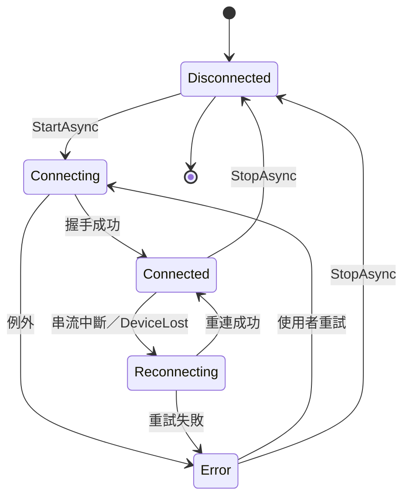

# 系統設計文件（SDD）

本文件描述「Android同步」的設計目標、需求、元件責任、主要流程、狀態機、錯誤處理與風險。實作細節請參閱 [ARCHITECTURE.md](ARCHITECTURE.md)。

---

## 1. 設計目標

1. **原生且低延遲**：在 Windows 11 上以原生 UI 與 GPU 管線呈現 Android 畫面，避免瀏覽器或跨平台框架的額外開銷。
2. **零第三方執行期依賴**：除 Windows App SDK 與 .NET 外，不引入商業或額外原生程式庫；影音使用作業系統 API。
3. **穩定可恢復**：連線中斷、解碼器或 D3D11 裝置遺失時能自動恢復，避免使用者手動重啟。
4. **完整桌面體驗**：提供視窗狀態記憶、置頂、精簡模式、截圖、剪貼簿、拖放與主題等桌面工作流。
5. **可維護**：分層架構、介面抽象、依賴注入與單元測試，便於替換或擴充。

## 2. 非目標

- 不提供螢幕錄影或遠端檔案瀏覽器。
- 不內建 ADB；使用者需自行安裝 Android Platform Tools。
- 不支援 Windows 10 或 ARM32。
- 不提供雲端配對、帳號或跨網際網路連線。
- 不保證所有 Android 客製化系統的完整功能（例如部分裝置限制音訊擷取）。

## 3. 利害關係人與使用情境

| 角色 | 需求 |
| --- | --- |
| 一般使用者 | 以滑鼠鍵盤操作手機、快速查看通知與訊息、拖放檔案 |
| 開發者 | 穩定的除錯與自動化操作環境 |
| 簡報／展示者 | 將手機畫面投放至 Windows，並隱藏手機螢幕 |
| 貢獻者 | 清楚的架構、可重現的建置與測試流程 |

### 主要使用案例

1. 以 USB 連接手機並開始同步。
2. 將 USB 連線轉為 Wi-Fi，之後一鍵重連。
3. 使用滑鼠、鍵盤與觸控操作手機。
4. 雙向剪貼簿與拖放檔案／安裝 APK。
5. 切換主題、置頂或精簡模式。
6. 連線中斷後自動恢復。

## 4. 功能需求（摘要）

| 編號 | 需求 | 優先級 |
| --- | --- | --- |
| FR-01 | 偵測 USB／Wi-Fi Android 裝置並顯示狀態 | 必要 |
| FR-02 | 支援無線配對、連線、USB 轉無線與記憶裝置 | 必要 |
| FR-03 | 即時同步手機畫面（H.264／H.265） | 必要 |
| FR-04 | 滑鼠點擊、拖曳、捲動、返回、主畫面 | 必要 |
| FR-05 | 側邊快捷列（返回、Home、多工、音量、電源、息屏、旋轉、斷線） | 必要 |
| FR-06 | 視窗狀態記憶與防越界還原 | 必要 |
| FR-07 | 應用程式圖示 | 必要 |
| FR-08 | 鍵盤與中文 IME 輸入 | 重要 |
| FR-09 | 雙向剪貼簿 | 重要 |
| FR-10 | 音訊同步（AAC／RAW） | 重要 |
| FR-11 | 自動重連與裝置遺失恢復 | 重要 |
| FR-12 | 截圖、置頂、精簡模式、貼合比例 | 重要 |
| FR-13 | 拖放傳檔與 APK 安裝 | 重要 |
| FR-14 | 顯示模式與五款主題 | 重要 |
| FR-15 | 效能 HUD | 選用 |
| FR-16 | 單一實例 | 選用 |

## 5. 非功能需求

| 類別 | 要求 |
| --- | --- |
| 效能 | 1080p／60 FPS 為目標；GPU 零拷貝路徑下避免 CPU 回讀影格 |
| 延遲 | 以有界佇列、最大呈現延遲 1、低延遲解碼與積壓追幀控制延遲 |
| 穩定性 | 解碼器、D3D11 與網路例外需被捕捉並可恢復；不得使 UI 凍結 |
| 相容性 | x64 與 ARM64；Windows 11 22000+；scrcpy v2/v3/v5 握手 |
| 可存取性 | 可點擊元素具 `AutomationProperties.Name`；圖示按鈕具工具提示 |
| 隱私 | 不收集遙測；設定僅存本機；僅連線本機 ADB 與區域網路 |
| 可維護性 | 分層、介面抽象、DI、單元測試、0 警告建置 |

## 6. 系統元件設計

| 元件 | 責任 | 對外介面 |
| --- | --- | --- |
| `SettingsService` | 載入／儲存 JSON 設定、原子寫入、快取 | `ISettingsService` |
| `AdbService` | 工具解析、裝置查詢、配對／連線、推送、安裝、轉發 | `IAdbService` |
| `AdbSmartSocketClient` | ADB daemon 直連、裝置追蹤、forward | 內部類別 |
| `DeviceManagerService` | 無線連線流程、常用裝置記憶 | `IDeviceManagerService` |
| `MirrorSessionService` | 工作階段生命週期、串流、音訊、重連、檔案推送 | `IMirrorSessionService` |
| `ScrcpyProtocolClient` | 三通道連線、握手、封包解析、控制寫入 | 類別 |
| `ScrcpyControlSerializer` | 控制封包二進位序列化 | 靜態方法 |
| `MediaFoundationH264Decoder` | H.264／HEVC 硬解與 CPU 回退 | 類別 |
| `D3D11SwapChainRenderer` | 交換鏈、Video Processor、截圖、裝置恢復 | 類別 |
| `MediaFoundationAacDecoder` | AAC → PCM | 類別 |
| `IAudioPlayer` 實作 | WASAPI／WaveOut PCM 播放 | `IAudioPlayer` |
| `ThemeService` | 顯示模式、主題字典、標題列 | `IThemeService` |
| `WindowStateService` | 視窗狀態還原與儲存 | `IWindowStateService` |
| `SingleInstanceGuard` | 單一實例 Mutex 與喚醒事件 | 類別 |

### 依賴方向

- Presentation → Services → Protocol／Media。
- Media 與 Protocol 不依賴 UI。
- Helpers 為無狀態工具，供各層使用。
- 所有服務由 `App.xaml.cs` 的 Host 註冊與注入。

## 7. 工作階段狀態機

- `Connecting`：推送伺服器、建立轉發、啟動程序、握手、初始化解碼與音訊。
- `Connected`：視訊／音訊／控制迴圈運作中。
- `Reconnecting`：依 `1.5s / 3s / 5s` 退避重建，最多三次。
- `Error`：顯示錯誤訊息，等待使用者操作。

## 8. 主要流程

### 8.1 啟動同步

1. 停止既有工作階段並清理資源。
2. 解析 `scrcpy-server` 路徑；若不存在則報錯。
3. 依裝置序號與檔案簽章判斷是否需重新推送。
4. 產生隨機 `scid` 與可用本機 TCP 埠。
5. 建立 ADB forward。
6. 依設定組裝 `scrcpy-server` 參數並啟動程序。
7. 建立 Video／Audio／Control 連線，讀取握手。
8. 初始化解碼器（注入 DXGI device manager）、音訊管線。
9. 啟動視訊讀取、解碼、音訊與控制迴圈。
10. 狀態切換為 `Connected`，UI 附加 `SwapChainPanel`。

### 8.2 視訊讀取與解碼

1. 讀取 12 bytes 標頭，解析 flags 與 payload size。
2. 以 `ArrayPool` 取得緩衝並讀取 payload。
3. 寫入容量 4 的有界 Channel。
4. 解碼迴圈取出封包；config 封包快取 SPS/PPS。
5. Key frame 時合併快取的 SPS/PPS 後送解碼。
6. 解碼輸出影格；若 Channel 仍有積壓，只更新 DPB、不渲染，以追幀。
7. 渲染完成後立即釋放輸出表面。

### 8.3 自動重連

1. 偵測網路結束、解碼錯誤或 D3D11 DeviceLost。
2. 設定狀態為 `Reconnecting`，清理既有資源。
3. 等待退避時間後重新執行連線流程。
4. 成功則回到 `Connected`；三次失敗則進入 `Error`。

### 8.4 檔案拖放

1. UI 接收 `Drop` 事件並取得檔案路徑。
2. `.apk`：執行 `adb install -r`。
3. 其他檔案：`adb push` 至 `/sdcard/Download/`，再觸發媒體掃描。
4. 以底部提示列顯示結果。

### 8.5 剪貼簿同步

1. 監聽 Windows `Clipboard.ContentChanged`。
2. 經 `ClipboardSyncCoordinator` 判斷是否需推送。
3. 以 `SET_CLIPBOARD` 傳送；手機回推時解析 `TYPE_CLIPBOARD`。
4. 判斷是否為自身推送或 IME 注入，避免迴圈。

## 9. 錯誤處理與降級策略

| 情境 | 處理 |
| --- | --- |
| 找不到 adb／scrcpy-server | 顯示環境警告；設定頁可指定路徑 |
| 裝置未授權 | 停用「開始同步」，提示使用者確認授權 |
| 推送或連線失敗 | 顯示 `scrcpy-server` 日誌摘要；必要時失效推送快取 |
| HEVC 解碼器不存在 | 自動退回 H.264 |
| DXVA 不可用 | 退回 CPU NV12→BGRA 路徑 |
| 音訊初始化失敗 | 停用音訊，維持畫面同步 |
| 串流中斷 | 自動重連；失敗後顯示錯誤 |
| D3D11 裝置遺失 | 重建裝置並觸發工作階段重連 |
| 設定檔損毀 | 記錄錯誤並使用預設設定 |
| 視窗位置越界 | 依目前工作區夾回可見範圍 |
| 剪貼簿寫入失敗 | 仍保存截圖，提示剪貼簿暫時無法寫入 |

所有例外皆透過 `Microsoft.Extensions.Logging` 記錄；正式版不輸出至主控台。

## 10. 效能設計

- **背壓**：視訊 Channel 容量 4，避免無上限記憶體成長。
- **追幀**：偵測積壓時略過過時影格渲染。
- **零拷貝**：DXVA 輸出紋理直接交給 Video Processor。
- **資源重用**：`ArrayPool`、音訊環形緩衝、MF sample／buffer、Video Processor View。
- **延遲控制**：低延遲 MFT、最大呈現延遲 1、PCM 80ms 上限。
- **啟動加速**：ADB Smart Socket 直連、伺服器推送快取、縮短連線初期輪詢。

效能目標（設計值，非保證）：

| 指標 | 目標 |
| --- | --- |
| 畫面延遲 | 有線連線下盡量低於 100ms |
| 幀率 | 1080p 下接近 60 FPS（依裝置與網路） |
| 音訊延遲 | 盡量低於 150ms（WASAPI 路徑） |
| CPU 使用率 | GPU 路徑下避免每幀 CPU 色彩轉換 |

## 11. 安全性與隱私設計

- 僅與本機 ADB（`127.0.0.1:5037`）及區域網路中的手機通訊。
- 不包含任何網路服務、帳號系統或遙測。
- 不儲存 ADB 授權金鑰；由 ADB 自身管理。
- 設定檔僅含路徑、偏好與視窗狀態，不含個資。
- 拖放與 APK 安裝為使用者主動操作，程式不自動下載或執行遠端內容。
- 日誌不記錄剪貼簿內容或檔案內容。

## 12. 部署設計

- 以未封裝（unpackaged）WinUI 3 應用程式提供。
- 發行版為 framework-dependent（非 Self-Contained）：需 .NET 10 Runtime 與 Windows App Runtime 1.8。
- 提供 x64 與 ARM64 兩種 ZIP；不提供安裝程式。
- `Tools/scrcpy-server` 隨程式散布；`adb.exe` 由使用者自行提供。

## 13. 風險與對策

| 風險 | 影響 | 對策 |
| --- | --- | --- |
| Android 客製系統限制 | 無法連線或音訊 | 顯示明確錯誤；提供無線配對與替代連線 |
| 顯示卡驅動差異 | 硬解失敗或花屏 | CPU 回退、HEVC 退回 H.264、裝置遺失重建 |
| Wi-Fi 抖動 | 延遲累積 | 有界佇列、追幀、可調解析度／位元率 |
| scrcpy 協議版本變動 | 握手失敗 | 版本設定欄位、v2/v3/v5 相容解析 |
| 第三方授權 | 散布爭議 | 內附 Apache-2.0 聲明、adb 不下載 |
| 未簽章執行檔 | SmartScreen 警告 | 文件說明；未來可考慮程式碼簽章 |

## 14. 未來擴充

- 多裝置同時鏡像（目前為單一工作階段）。
- 檔案拖放進度條與取消。
- 自訂按鍵映射與巨集。
- 錄影與 GIF 匯出（目前列為非目標）。
- 可設定的硬體解碼器優先順序。
- 安裝程式與自動更新。

## 15. 驗收準則

1. `dotnet build` 與 `dotnet test` 皆為 0 警告、0 錯誤。
2. x64 與 ARM64 皆可成功發佈並產生 ZIP。
3. 於 Windows 11 可啟動，完成 USB 連線與畫面同步。
4. 滑鼠、鍵盤、快捷列、剪貼簿、音訊與拖放功能可用。
5. 關閉程式後不殘留 `scrcpy-server` 或 ADB 轉發。
6. 設定與視窗狀態可跨啟動保存。
